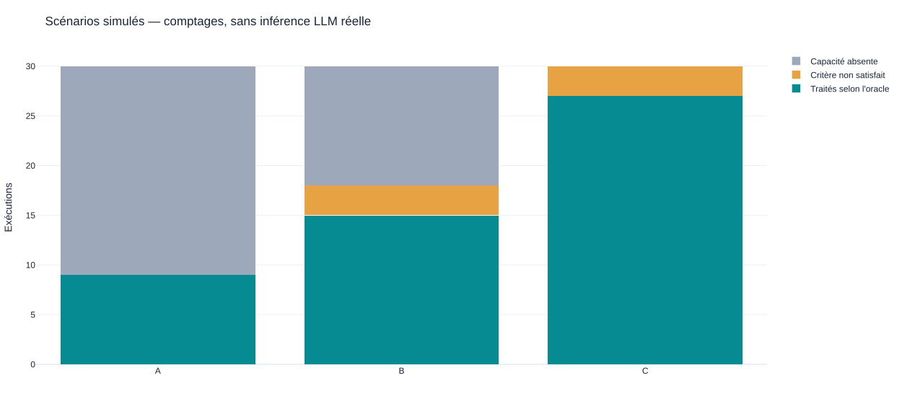
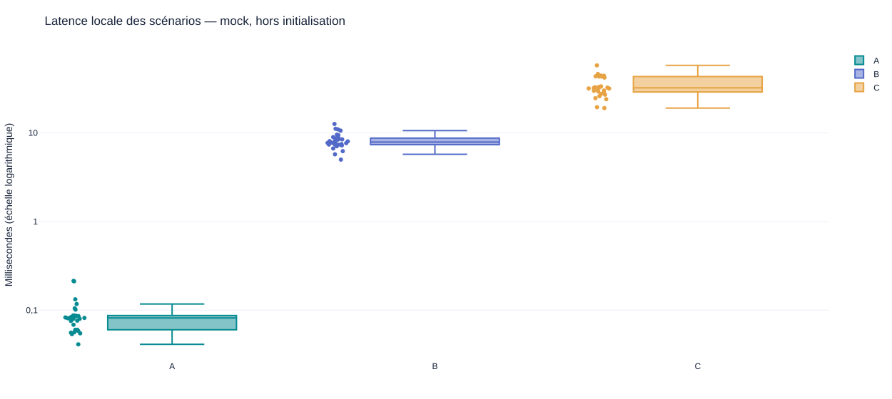
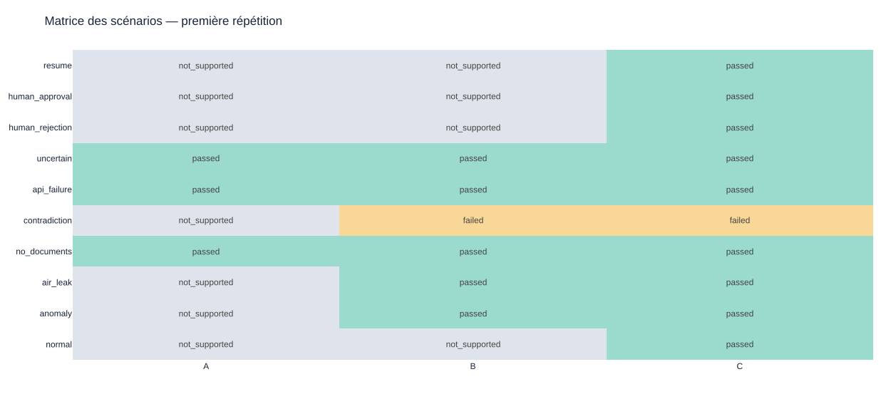
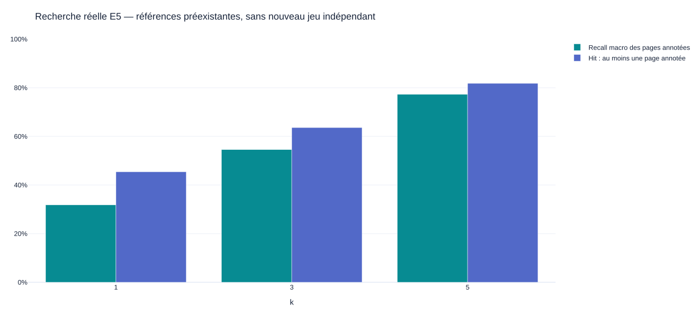
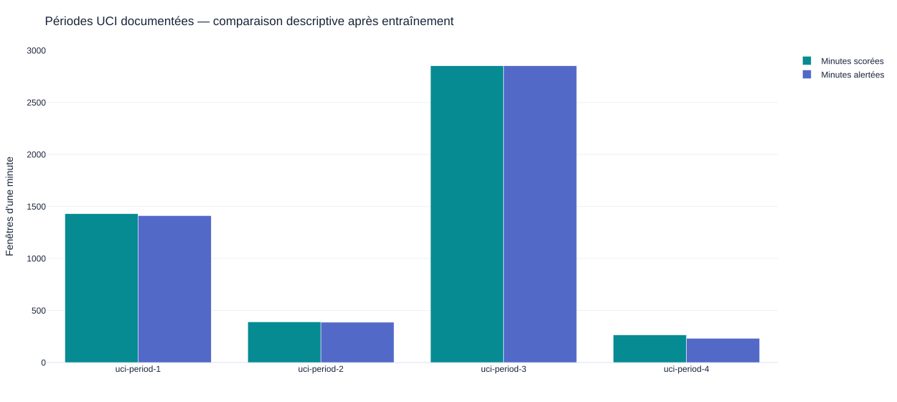

# Campagne d'évaluation du prototype MetroPT

Exécution UTC : 2026-11-16T12:38:29.081598+00:00

## Protocole et configurations

Comparaison de contrats et de capacités avec mock, pas un benchmark de LLM ni un classement clinique.

| Configuration | Périmètre |
| --- | --- |
| A | LLM seul — adaptateur sans ML ni RAG |
| B | LLM + RAG — sans graphe ni revue persistante |
| C | ML + RAG + LangGraph + revue humaine |

10 scénarios × 3 configurations × 3 répétitions = 90 exécutions simulées. Rotation de l'ordre A/B/C. Initialisation du corpus exclue des latences.

## Résultats des scénarios simulés

| Configuration | Traités / total | Critère non satisfait | Capacité absente | Taux traité | Médiane (s) | p95 (s) | Fidélité littérale / citations |
| --- | --- | --- | --- | --- | --- | --- | --- |
| A | 9 / 30 | 0 | 21 | 30,0 % | 0,000082 | 0,000176 | NA / 0 |
| B | 15 / 30 | 3 | 12 | 50,0 % | 0,008 | 0,011 | 100,0 % / 24 |
| C | 27 / 30 | 3 | 0 | 90,0 % | 0,032 | 0,045 | 100,0 % / 21 |

Le taux traité utilise tous les scénarios au dénominateur, y compris les capacités absentes. Ce taux compare l'étendue des architectures selon des oracles explicites, sans démontrer une supériorité de raisonnement.

| Scénario | Critère | A | B | C |
| --- | --- | --- | --- | --- |
| Fonctionnement normal simulé | normal_without_llm | not_supported | not_supported | passed |
| Anomalie simulée | documented_response | not_supported | passed | passed |
| Suspicion de fuite, non confirmée | documented_response | not_supported | passed | passed |
| Documentation pertinente absente | honest_abstention | passed | passed | passed |
| Deux documents pédagogiques contradictoires | conflict_exposed | not_supported | failed | failed |
| Erreur API injectée | api_failure_visible | passed | passed | passed |
| Diagnostic incertain | uncertainty_explicit | passed | passed | passed |
| Refus humain simulé | rejection_recorded | not_supported | not_supported | passed |
| Approbation humaine simulée | explicit_approval_only | not_supported | not_supported | passed |
| Reprise d'une interruption persistante | resume_without_recomputation | not_supported | not_supported | passed |

### Diagnostic et contradictions

| Configuration | Faits conservés / dossiers vérifiés | Incertitude explicite / dossiers | Hypothèses mock | Qualité clinique |
| --- | --- | --- | --- | --- |
| A | 100,0 % / 30 | 100,0 % / 30 | 0 | NA |
| B | 100,0 % / 30 | 100,0 % / 30 | 0 | NA |
| C | 100,0 % / 24 | 100,0 % / 24 | 0 | NA |

La conformité des faits, l'incertitude explicite et les citations sont auditées automatiquement. Le nombre d'hypothèses produites par le mock est publié dans metrics.json. Une absence d'hypothèse ne démontre pas la justesse d'un diagnostic.

Le scénario contradictoire exige les deux affirmations opposées comme arguments et un signalement d'insuffisance documentaire. Le mock sélectionne un seul extrait ; B et C ne satisfont pas cet oracle. Le prototype ne dispose pas de détecteur sémantique de contradictions. Une proposition peut donc rester approuvable comme préparation documentaire malgré ce conflit non identifié : point à traiter avant tout usage au-delà de la démonstration.

### Validation humaine

| Configuration | Approbations avant revue | Dossiers exigeant revue | Revues explicites | Interruptions conformes | Reprises conformes | API LLM réelle |
| --- | --- | --- | --- | --- | --- | --- |
| A | 0 | NA | NA | NA | NA | 0 |
| B | 0 | NA | NA | NA | NA | 0 |
| C | 0 | 27 | 9 | 100,0 % | 100,0 % | 0 |

A et B ne possèdent pas de mécanisme de revue ni de reprise : leurs zéros ne prouvent pas l'existence d'un garde-fou. C est vérifié par interruption réelle, soumission explicite sur fixture synthétique, réouverture du checkpoint et lecture du reçu SQLite.

## Données réelles et PDF réels

Ce volet réutilise les artefacts figés et le modèle existant. Il n'entraîne ni ne calibre le modèle. Les éventuelles générations restent mock.

### Détection ML

| Partition | Fenêtres scorées | Alertes | Fraction alertée |
| --- | --- | --- | --- |
| train | 26301 | 273 | 1,0 % |
| calibration | 9031 | 90 | 1,0 % |
| test | 215611 | 33491 | 15,5 % |

| Période UCI | Minutes scorées | Minutes alertées | Couverture observée | Fraction alertée |
| --- | --- | --- | --- | --- |
| uci-period-1 | 1430 | 1412 | 99,3 % | 98,7 % |
| uci-period-2 | 391 | 387 | 100,0 % | 99,0 % |
| uci-period-3 | 2852 | 2852 | 90,5 % | 100,0 % |
| uci-period-4 | 265 | 233 | 97,8 % | 87,9 % |

Périodes observables avec au moins une alerte : 4 / 4. Pas de vérité terrain binaire exhaustive. Couverture des quatre périodes rapportées et fractions de minutes alertées : mesures descriptives, pas recall de diagnostic de fuite. Hors période = non étiqueté. Aucun réentraînement ni ajustement de seuil.

Precision = NA ; Recall de défaillance = NA ; F1 = NA. Aucune de ces valeurs n'est remplacée par zéro.

### Recall@k documentaire

11 questions avec références et 6 demandes d'abstention, sur 851 pages physiques et 4337 chunks.

| k | Recall macro pages annotées | Hit@k |
| --- | --- | --- |
| 1 | 31,8 % | 45,5 % |
| 3 | 54,5 % | 63,6 % |
| 5 | 77,3 % | 81,8 % |

Recall@k(q) = nombre de pages annotées retrouvées parmi les k premiers passages / nombre de pages annotées. Moyenne par question ; doublons dédupliqués. Hit@k exige seulement une page annotée.

Abstention selon les annotations historiques : 83,3 %. Annotations préexistantes non indépendantes, parfois pages alternatives ; recall calculé sur toutes les pages listées, sans prétendre couvrir toutes les pages pertinentes du corpus. Questions déjà utilisées pendant le développement. Pas de généralisation.

Attention au périmètre de référence : le cas UCI « Quelle procédure de consignation de sécurité appliquer avant démontage ? » avait été déclaré non répondable sans guides de sécurité. Des passages INRS sont désormais disponibles. Le désaccord avec cette annotation est publié, mais ne prouve pas un échec sémantique ; leur applicabilité exacte reste à examiner. Le jeu n'a pas été réétiqueté après observation des résultats.

| Question | Références attendues | Références retournées | Recall@5 | Latence (s) |
| --- | --- | --- | --- | --- |
| Dans quelle unité est mesurée la température de l'huile ? | Data Description_Metro.pdf p.2 | P-2010-FR-7-23_23-4888.pdf p.3; nasa-rcmguide.pdf p.436; P-2010-FR-7-23_23-4888.pdf p.6; nasa-rcmguide.pdf p.440; nasa-rcmguide.pdf p.456 | 0,0 % | 0,271 |
| Que mesure Motor Current et quelle est son unité ? | Data Description_Metro.pdf p.2 | nasa-rcmguide.pdf p.134; nasa-rcmguide.pdf p.84; nasa-rcmguide.pdf p.109; Data Description_Metro.pdf p.2; nasa-rcmguide.pdf p.242 | 100,0 % | 0,105 |
| À quoi correspond le signal TOWERS ? | Data Description_Metro.pdf p.3 | Data Description_Metro.pdf p.3 | 100,0 % | 0,108 |
| Que mesure TP2 et dans quelle unité ? | Data Description_Metro.pdf p.2 | Data Description_Metro.pdf p.2 | 100,0 % | 0,077 |
| Quel est le couple de serrage de la culasse ? |  |  | NA | 0,079 |
| Quelle procédure de consignation de sécurité appliquer avant démontage ? |  | ed6109.pdf p.7; ed6109.pdf p.13; ed6109.pdf p.27; ed6109.pdf p.14; ed6129.pdf p.11 | NA | 0,093 |
| Quelle est la recette d'un gâteau au chocolat ? |  |  | NA | 0,080 |
| According to NASA, what is the purpose of Failure Modes and Effects Analysis (FMEA)? | nasa-rcmguide.pdf p.39; nasa-rcmguide.pdf p.40 | nasa-rcmguide.pdf p.240; nasa-rcmguide.pdf p.39; nasa-rcmguide.pdf p.48; nasa-rcmguide.pdf p.139; nasa-rcmguide.pdf p.12 | 50,0 % | 0,177 |
| According to the NASA guide, what does lubricant and wear particle analysis determine? | nasa-rcmguide.pdf p.94; nasa-rcmguide.pdf p.95 | nasa-rcmguide.pdf p.129; nasa-rcmguide.pdf p.100; nasa-rcmguide.pdf p.171; nasa-rcmguide.pdf p.173; nasa-rcmguide.pdf p.175 | 0,0 % | 0,081 |
| How are compressed air leaks detected with an ultrasonic acoustic detector in the DOE sourcebook? | compressed_air_sourcebook.pdf p.32; compressed_air_sourcebook.pdf p.33 | compressed_air_sourcebook.pdf p.32; compressed_air_sourcebook.pdf p.33; compressed_air_sourcebook.pdf p.65; compressed_air_sourcebook.pdf p.67; compressed_air_sourcebook.pdf p.34 | 100,0 % | 0,124 |
| Selon le guide KAESER, pourquoi sécher l'air comprimé ? | P-2010-FR-7-23_23-4888.pdf p.6 | P-2010-FR-7-23_23-4888.pdf p.4; P-2010-FR-7-23_23-4888.pdf p.7; P-2010-FR-7-23_23-4888.pdf p.6 | 100,0 % | 0,081 |
| Selon le guide KAESER, d'où proviennent les condensats dans l'air comprimé ? | P-2010-FR-7-23_23-4888.pdf p.7; P-2010-FR-7-23_23-4888.pdf p.8 | P-2010-FR-7-23_23-4888.pdf p.7; P-2010-FR-7-23_23-4888.pdf p.16; P-2010-FR-7-23_23-4888.pdf p.17; P-2010-FR-7-23_23-4888.pdf p.8; P-2010-FR-7-23_23-4888.pdf p.6 | 100,0 % | 0,069 |
| How does a refrigerant dryer remove water from compressed air in the Atlas Copco manual? | The Compressed Air Manual - Ed. 9.pdf p.48 | The Compressed Air Manual - Ed. 9.pdf p.51; The Compressed Air Manual - Ed. 9.pdf p.120; The Compressed Air Manual - Ed. 9.pdf p.122; The Compressed Air Manual - Ed. 9.pdf p.48; The Compressed Air Manual - Ed. 9.pdf p.46 | 100,0 % | 0,099 |
| What is the working principle of adsorption drying in the Atlas Copco manual? | The Compressed Air Manual - Ed. 9.pdf p.49; The Compressed Air Manual - Ed. 9.pdf p.50 | The Compressed Air Manual - Ed. 9.pdf p.49; The Compressed Air Manual - Ed. 9.pdf p.78; The Compressed Air Manual - Ed. 9.pdf p.50; The Compressed Air Manual - Ed. 9.pdf p.120; The Compressed Air Manual - Ed. 9.pdf p.142 | 100,0 % | 0,073 |
| Quel est le couple de serrage exact de la culasse du compresseur MetroPT-3 ? |  |  | NA | 0,068 |
| Quelle procédure de consignation est spécifiquement validée pour le compresseur MetroPT-3 ? |  |  | NA | 0,083 |
| Quelle est la recette d'un gâteau au chocolat ? |  |  | NA | 0,059 |

### Parcours sur mesures historiques

Première minute test scorée sans alerte et première minute test alertée dans les prédictions figées. Ces sélections ne constituent pas une vérité terrain.

Temps applicatif local hors préparation commune ; mock sans inférence générative distante. Réouverture du checkpoint vérifiée après mesure. Une première exécution peut inclure des caches froids.

| Cas choisi par le modèle | Configuration | n | Médiane (s) | Appels mock | Dossiers en attente | Revues soumises |
| --- | --- | --- | --- | --- | --- | --- |
| model_not_flagged | A | 3 | 0,000169 | 3 | 0 | 0 |
| model_not_flagged | B | 3 | 0,148 | 3 | 0 | 0 |
| model_not_flagged | C | 3 | 0,100 | 0 | 0 | 0 |
| model_flagged | A | 3 | 0,000186 | 3 | 0 | 0 |
| model_flagged | B | 3 | 0,161 | 3 | 0 | 0 |
| model_flagged | C | 3 | 0,272 | 3 | 3 | 0 |

Aucune décision humaine n'a été soumise sur ces mesures réelles. Aucune validation de cause ni procédure physique n'a été produite.

## Graphiques exportés

## Qualité diagnostique : grille restant à faire évaluer

| Dimension | Mesure disponible | Référence nécessaire |
| --- | --- | --- |
| Faits et unités | Correspondance exacte aux entrées | Mesures fournies |
| Citations | Fidélité littérale avec dénominateur | PDF, page et empreinte |
| Pertinence des hypothèses | NA — pas de notation clinique | Experts indépendants, dossier anonymisé |
| Exhaustivité et contradictions | Oracle pédagogique ; pas de score sémantique général | Corpus applicable et annotation experte |
| Cause réelle | NA | Diagnostic terrain confirmé, indépendant du modèle |
| Utilité et applicabilité des contrôles | NA | Notice exacte et validation compétente |

## Tests automatisés

{"source": "evaluation_tests.xml", "tests": 258, "passed": 258, "failures": 0, "errors": 0, "skipped": 0, "time_seconds": 25.527, "suite_timestamps": ["2026-11-16T13:44:26.163096+01:00"]}

## Limites méthodologiques

- Aucun LLM génératif réel n'a été évalué : le même mock déterministe est utilisé pour A, B et C. L'erreur API est injectée. Les latences ne mesurent pas une API ni une inférence LLM.

- A et B sont des adaptateurs d'ablation, pas deux nouveaux modes de production. Les mesures sont identiques ; ils n'ont ni score ML ni validation persistante. Leur absence de capacité est déclarée non prise en charge, pas assimilée à une hallucination.

- Dans les dix scénarios, mesures et PDF sont fabriqués et le résultat ML est injecté. Le vrai graphe, Chroma, PyMuPDF, les validateurs et SQLite sont exécutés. Les vecteurs synthétiques ne mesurent pas la qualité E5.

- Les scénarios de fuite restent des suspicions. Aucune fuite n'est confirmée par l'absence ou la présence d'une alerte. Aucun nouveau label de panne n'est créé.

- La fidélité calculée est la proportion de citations littéralement présentes dans les sources vérifiées. Une citation exacte peut être non pertinente ou insuffisante ; cette mesure n'est pas une fidélité sémantique ni une qualité causale.

- La qualité clinique des diagnostics exige une évaluation indépendante par des personnes compétentes et des références applicables à l'équipement. Elle reste non mesurée. Le mock ne produit aucune hypothèse : ce comportement ne prouve pas la qualité d'un LLM réel.

- La contradiction est un oracle pédagogique explicite, pas une contradiction découverte dans les vrais manuels. Deux sources présentes et une incertitude générique ne suffisent pas : les affirmations opposées doivent être citées et l'insuffisance signalée.

- Pas de labels binaires exhaustifs sur MetroPT-3 : Precision, Recall de défaillance et F1 restent NA. La couverture des quatre périodes documentées est uniquement descriptive ; les autres dates restent non étiquetées.

- Les annotations documentaires préexistent à cette campagne mais ont servi au développement. Jeu petit, pages parfois alternatives, sans nouveau jeu tenu à l'écart ; les métriques ne sont pas une estimation indépendante de généralisation.

- Les questions UCI avaient été annotées pour un corpus limité au PDF du dataset. Le corpus actuel contient aussi INRS : une demande générale sur la consignation peut maintenant retrouver des sources. L'écart à l'abstention historique exige une réannotation indépendante ; il ne démontre à lui seul ni hallucination ni applicabilité à MetroPT. Les annotations et scores historiques sont conservés sans correction après observation.

- Répétitions déterministes locales, caches partagés et effectifs faibles : médiane et p95 descriptifs, sans test statistique de supériorité. Les temps de préparation communs sont séparés ; la première exécution peut inclure des caches froids.

- Les décisions d'approbation/refus de la campagne sont injectées uniquement sur des fixtures synthétiques et dans un stockage séparé. Aucun dossier réel n'est approuvé. Une approbation documentaire ne déclenche aucune action physique.
