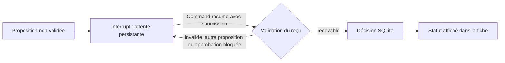

# Supervision humaine et fiche de revue

Chaque proposition déclenche une interruption persistante de LangGraph dans
`human_review_node`. Le dossier reste non approuvé jusqu'à une soumission humaine
explicite et valide. Les mesures normales sont clôturées sans validation humaine ;
les données insuffisantes ne sont jamais traitées comme normales.

## Fiche Streamlit

La fiche présente l'identifiant du workflow et le statut de validation, puis :

- les mesures fournies, leurs unités/agrégations, la fenêtre historique, le score
  et le seuil d'anomalie, avec rappel qu'il ne s'agit pas d'une probabilité de panne ;
- les hypothèses documentées et non confirmées, ou leur absence explicite ;
- les sources avec vrai nom du PDF, page physique, provenance, portée et passages ;
- les contrôles documentaires ou analyses de données proposés ;
- les informations manquantes et l'éventuel blocage de l'approbation ;
- après décision, l'identifiant du validateur, les horodatages UTC et ses commentaires.

Les textes documentaires et commentaires sont affichés comme du texte, sans
exécuter leurs instructions. Les données synthétiques et le diagnostic mock
portent des mentions distinctes. Le journal et le JSON technique restent
consultables dans un panneau repliable, sans remplacer la fiche.

Trois boutons sont proposés, sans choix présélectionné :

| Action | État enregistré | Approbation humaine |
| --- | --- | --- |
| Approuver | `approved_documentary_proposal` | Oui, pour la préparation documentaire uniquement |
| Refuser | `rejected` | Non |
| Demander une révision | `revision_requested` | Non ; correction demandée dans les commentaires |

Les trois actions exigent un identifiant de validateur et un commentaire non
vides, puis une case de confirmation explicitement cochée. L'approbation reste
désactivée si le dossier est bloqué. Le serveur applique les mêmes validations
indépendamment des boutons. Le contrat Pydantic est partagé par le graphe et
le stockage dans `maintenance/review.py`.

La proposition reste un instantané du dossier soumis. La décision fait foi pour
son statut de validation ; un simple champ `human_validated=true` sans reçu valide
ne suffit pas. Une décision reçue dont l'écriture a échoué est affichée comme
« enregistrement en attente », sans afficher une approbation persistée.

Une demande de révision conserve les commentaires et clôt ce dossier avec un
statut non approuvé. Après corrections, créer un nouveau dossier ; aucune
réécriture automatique du plan ou nouvelle hypothèse n'est lancée. Le précédent
code API `request_information` reste lisible et accepté pour compatibilité,
mais les trois boutons utilisent les codes du tableau.

## Interruption, reprise et persistance

L'identifiant du workflow correspond au `thread_id`. Les checkpoints sont dans
`data/local/workflow/checkpoints.sqlite`. Pour retrouver le dossier après fermeture
de l'application, saisir cet identifiant dans « Identifiant du dossier à rouvrir »
et cliquer sur « Rouvrir le dossier enregistré ». La reprise d'une revue ne
relance ni le ML, ni le RAG, ni le LLM.

Le backend soumet `Command(resume={interrupt_id: submission})`, avec l'identifiant
effectif de l'interruption. Une réponse vide, non confirmée ou liée à une autre
proposition laisse le dossier en attente. Une revue d'un dossier déjà clos est
refusée. Aucun validateur ou commentaire n'est produit par le modèle.

Les décisions sont dans `data/local/workflow/decisions.sqlite`, table
`workflow_decisions` :

| Colonne | Contenu |
| --- | --- |
| `run_id` | Identifiant unique du workflow |
| `decision` | Résultat normal, approbation documentaire, refus ou révision |
| `decided_at_utc` | Horodatage serveur de l'enregistrement |
| `validator_id` | Identifiant déclaré du validateur ; nul pour une clôture normale |
| `comments` | Commentaire exact après suppression des espaces périphériques |
| `record_json` | Dossier de décision, reçu confirmé, référence de proposition, événement ML et dates |

Le reçu conserve aussi `reviewed_at_utc` dans le dossier JSON. Les dates des
capteurs restent sans fuseau inventé ; seuls les horodatages de revue et
d'enregistrement sont explicitement UTC.

Les tables antérieures à deux colonnes sont migrées transactionnellement à leur
ouverture par `DecisionStore`. Les métadonnées sont extraites uniquement de reçus
valides ; aucune validation n'est créée pendant la migration. Le JSON d'origine
est conservé. Une ligne incohérente est refusée, sans conversion en approbation.

Le stockage revalide chaque décision, y compris si un appelant utilise les
constructeurs Pydantic qui contournent la validation. Pour une approbation, il
exige une soumission `approve`, une confirmation booléenne `true`, un identifiant
de proposition concordant, un validateur et un commentaire valides, ainsi que
des dates UTC cohérentes. Les métadonnées SQL doivent correspondre au reçu.
Les décisions lues depuis un checkpoint sont également revalidées avant affichage.

Les écritures restent idempotentes : une seule décision par dossier, avec refus
d'un contenu différent. La reprise de `finalize_node` après une erreur SQLite
conserve la date et la décision initiales, sans doublon ni nouveau calcul LLM.
Le mécanisme est expliqué dans `docs/workflow_langgraph.md`.

## Vérifications

Commande réellement exécutée : `python -m pytest` — **224 tests réussis**, dont
**57 tests du workflow, de la fiche et des décisions**. Les trois actions sont
exercées via Streamlit AppTest, avec fermeture/réouverture du dossier. Les tests
vérifient notamment :

- absence d'approbation avant revue explicite et confirmation obligatoire ;
- rejet d'un reçu absent, vide, non confirmé ou lié à une autre proposition ;
- rejet des substitutions de décision, validateur, commentaire ou horodatage ;
- rejet d'une approbation falsifiée dans un checkpoint ;
- révision demandée restant non approuvée après redémarrage ;
- migration SQLite, cohérence des colonnes et enregistrement sans doublon.

Les données, documents et validations utilisés par ces tests sont explicitement
synthétiques. Aucun dossier réel n'est approuvé automatiquement. L'identité du
validateur reste déclarative dans ce prototype local, sans authentification
industrielle ni contrôle d'accès ajouté. Une approbation documentaire ne confirme
aucune cause de panne et n'autorise ni ne déclenche une intervention physique.

Un essai supplémentaire a été exécuté dans Chromium via Playwright sur un
dossier entièrement synthétique : présence des rubriques, boutons initialement
désactivés, confirmation explicite, demande de révision puis réouverture dans
une nouvelle session. Les colonnes SQLite et le statut non approuvé ont été
vérifiés après l'action. Aucun appel LLM réel n'a eu lieu. Le rapport est dans
`docs/human_supervision_validation.json` ; les captures et bases de test restent
locales dans `work/supervision_browser/`.
