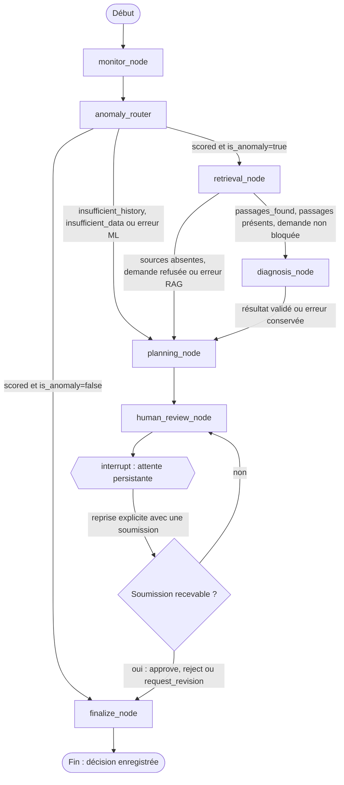

# Workflow LangGraph supervisé

Le workflow relie les modules existants sans confier le choix des outils au LLM.
Le graphe est borné : ML, routage, recherche documentaire, diagnostic, préparation
documentaire, revue humaine puis enregistrement. La seule boucle attend une
nouvelle soumission de revue lorsqu'une réponse est invalide. Aucun nœud ne
commande le compresseur et aucun modèle ne peut approuver une proposition.

## Transitions et conditions



Le dessin brut produit par le vrai graphe figure dans `docs/workflow_graph.mmd`.
Les étiquettes ci-dessus explicitent les conditions métier.

| Nœud | Traitement et garde-fous |
| --- | --- |
| `monitor_node` | Agrège les mesures avec `aggregate_minutes`, construit les variables causales avec `engineer_features`, charge le modèle local et appelle `predict_anomaly`. Aucun `fit` ni modification de seuil. |
| `anomaly_router` | Sépare normalité statistique, anomalie, historique/données insuffisants et erreur ML. Une fenêtre non scorée ne peut pas suivre la branche normale. |
| `retrieval_node` | Appelle `search_documents` avec la question du dossier. Conserve passages, références, refus et avertissements. Une absence de sources ou un refus évite le diagnostic et tout appel LLM. |
| `diagnosis_node` | Réutilise `generate_diagnostic`, ses sources vérifiées et son schéma Pydantic. Conserve aussi les résultats `erreur_api`, `reponse_invalide` ou autres états d'erreur. |
| `planning_node` | Reprend uniquement le catalogue de contrôles documentaires/analytiques. Lie la proposition au dossier et à un hash de son contenu. Un diagnostic indisponible ou en erreur bloque son approbation. |
| `human_review_node` | Suspend avec `interrupt()`. Vérifie identité déclarée, commentaire, décision, confirmation explicite et identifiant exact de proposition. Refuse une approbation bloquée et attend une nouvelle soumission. |
| `finalize_node` | Enregistre une clôture normale ou la décision humaine dans SQLite. Une clôture normale a `human_validated=false`. Une approbation reste strictement documentaire ; toutes les autorisations/actions physiques restent fausses. |

## État typé et mémoire

`WorkflowState` est un `TypedDict`. Il contient exclusivement des primitives
sérialisables : identifiant, requête, phase/route, mesures agrégées, événement ML,
résumé du monitorage, recherche, diagnostic, proposition, revue, décision, erreurs
et journal. `WorkflowRequest` et `HumanReview` sont validés avec Pydantic strict.
Les résultats de diagnostic et propositions possèdent également leur schéma.

Le modèle ML, le client Chroma, le fournisseur LLM et la clé API restent dans
les dépendances applicatives, hors état. Le sérialiseur des checkpoints n'active
ni fallback pickle ni reconstruction d'objets applicatifs. Le modèle Joblib
doit provenir d'un artefact local de confiance produit par le projet.

`open_workflow()` ouvre un `SqliteSaver` et ferme sa connexion en fin de contexte.
`thread_id` correspond à l'identifiant de dossier généré par le serveur. Chaque
démarrage crée un nouveau dossier ; une revue ne peut pas être injectée dans
l'état initial. `durability="sync"` conserve les checkpoints aux étapes du graphe.
Réouvrir le même dossier SQLite permet de retrouver une interruption après
fermeture de l'application. Les checkpoints et décisions restent locaux et
ignorés par Git. Le traçage distant est désactivé via `tracing_context(enabled=False)`.

Chaque étape parcourue ajoute une entrée séquencée au journal et utilise le
logger Python `metropt.workflow`. Pour afficher aussi les événements en console :

```python
import logging
logging.basicConfig(level=logging.INFO)
```

Le journal est inclus dans les checkpoints et visible dans Streamlit. La mise
en attente est annoncée dans l'état à la fin de la préparation ; l'interruption
effective figure dans le snapshot LangGraph. Le nœud humain ne produit aucun
effet externe avant `interrupt()`, puisqu'il est réexécuté lors d'une reprise.
Les erreurs inattendues des services sont exposées comme des codes fixes sans
recopier de réponse distante, de texte PDF ou de secret dans les logs d'erreur.

## Mesures et limites d'analyse

Une exécution examine la **dernière minute close** d'une fenêtre bornée. Les
minutes précédentes fournissent son contexte causal. Les anomalies antérieures
de cette fenêtre ne déclenchent pas d'autres dossiers automatiquement. Il ne
s'agit ni d'une surveillance exhaustive de tout le CSV ni d'une acquisition
temps réel. Un orchestrateur de rejeu continu reste une étape distincte.

`load_measurement_window()` lit les blocs de 10 000 lignes jusqu'au bloc contenant
la fin demandée et conserve au plus 6 000 mesures sélectionnées. Le CSV n'a pas
d'index temporel : atteindre une date tardive demande de lire son préfixe.
L'ordre est vérifié sur la portion lue ; aucun tri implicite. Un dépassement de
limite est refusé. La fenêtre ouverte finale est écartée ; les trous réinitialisent
les variables temporelles comme dans la baseline existante.

Le type historique/synthétique est déclaré explicitement. La structure du CSV
et des dates est vérifiée, sans prétendre authentifier sa provenance. L'empreinte
globale du CSV n'est pas recalculée pour ce petit intervalle ; le champ source
SHA-256 de l'événement peut donc être nul. Les dates des capteurs ne reçoivent
pas de fuseau inventé. Les dates du journal sont explicitement UTC.

## Proposition et validation humaine

La proposition prépare un dossier avant intervention : examen de données,
contexte de fonctionnement, consultation de l'historique, obtention de notice
et examen de sécurité compétent. Les descriptions viennent du catalogue fixe
du diagnostic. Les références indiquent le contexte documentaire fourni ; elles
ne justifient pas une opération de terrain. Aucun délai, pièce à changer,
consigne, norme, coût ou mode opératoire n'est inventé.

Le corpus actuel ne contient pas de notice identifiée du compresseur MetroPT-3.
`physical_procedure` reste nul ; toute intervention réelle reste à définir avec
des documents applicables et des personnes compétentes. Un dossier recevable
peut faire l'objet d'une approbation documentaire même si des informations
techniques restent à compléter. Cette approbation ne valide ni une cause de
panne, ni une procédure physique. Le mock est clairement identifié comme simulation.

La proposition affichée reste un instantané `proposition non validée`. Sa
décision ultérieure figure séparément dans `review` puis `decision`, pour ne
pas modifier rétroactivement le contenu lié au hash soumis au relecteur.

Pour reprendre une attente après redémarrage :

```python
import json
from metropt_maintenance.orchestration import open_workflow

run_id = input("Identifiant du dossier enregistré : ").strip()
with open_workflow() as runner:
    state = runner.get_state(run_id)
    print(state["interrupts"])  # dossier à examiner avant de décider
    # Saisir uniquement après examen humain ; aucun choix par défaut.
    submission = json.loads(input("Soumission de revue humaine au format JSON : "))
    state = runner.review(run_id, submission)
    print(state["phase"], state["decision"])
```

La soumission doit contenir exactement :

| Champ | Exigence |
| --- | --- |
| `proposal_id` | Hash de la proposition affichée pour ce dossier |
| `decision` | `approve`, `reject` ou `request_revision` ; ancien code `request_information` conservé pour compatibilité |
| `reviewer` | Identifiant déclaré du validateur, non vide |
| `comment` | Commentaire non vide |
| `acknowledged` | Booléen `true` explicite, jamais implicite ou numérique |

Quand le dossier est bloqué, seules `reject`, `request_revision` et l'ancien `request_information` sont
recevables. Une soumission invalide conserve l'attente et le même dossier,
sans nouveau calcul ML, RAG ou LLM. Une demande de révision clôt ce dossier
avec le statut `revision_requested`, sans approbation ; un nouveau dossier doit
être créé après correction des données ou documents. L'ancien code de demande
d'informations conserve son statut `information_requested`.
L'application n'invente pas automatiquement une nouvelle proposition.

Dans Streamlit, la fiche expose les faits, hypothèses, sources/pages, contrôles,
informations manquantes et statut réel. Les trois boutons sont « Approuver »,
« Refuser » et « Demander une révision ». La case de confirmation est décochée
et les boutons restent désactivés sans identifiant, commentaire et confirmation.
L'identité est déclarative : ce prototype local n'intègre pas d'authentification
ou de contrôle d'accès industriel. Les sources et modèles sont des instantanés
du traitement ; le relecteur doit vérifier leur actualité et leur applicabilité.

## Enregistrement et reprise sur erreur

Les checkpoints sont dans `data/local/workflow/checkpoints.sqlite` et les décisions
dans `data/local/workflow/decisions.sqlite`, table `workflow_decisions`. Il n'y a
qu'une décision par identifiant. Un enregistrement rejoué avec le même contenu
renvoie la décision initiale ; un contenu différent est refusé. Les requêtes SQL
utilisent des paramètres. Ce stockage est limité aux décisions de ce workflow.
Les colonnes `decision`, `decided_at_utc`, `validator_id` et `comments` rendent
l'audit accessible directement en SQL. Les anciennes tables à deux colonnes sont
migrées transactionnellement ; les métadonnées sont déduites des reçus existants
valides. Avant écriture, le stockage revalide le reçu, son identifiant de proposition,
la décision, le validateur et les dates UTC. Une approbation sans reçu confirmé
ou une substitution de métadonnées est refusée. Les décisions d'un checkpoint
sont aussi revalidées à la lecture avant affichage du statut.

Les deux écritures, décision puis checkpoint de fin, ne forment pas une transaction
commune. Le test de reprise simule donc un arrêt après écriture de la décision
et avant fin du nœud : la reprise ne crée pas de doublon et conserve la date
initiale. Un échec de persistance lève `WorkflowPersistenceError`, avec `run_id`.
Après correction du stockage, reprendre seulement cette finalisation :

```python
with open_workflow() as runner:
    state = runner.retry_finalization(run_id)
```

Le bouton correspondant apparaît aussi dans Streamlit. Cette reprise ne repasse
pas par les modules ML/RAG/LLM. Un dossier déjà clôturé ne peut pas être validé
une deuxième fois via l'API de revue.

## Vérifications exécutées

`python -m pytest` : **224 tests réussis**, dont **57 tests d'orchestration,
proposition et persistance**. Ils vérifient les branches normales et anormales,
les sources absentes, refus à risque, erreurs ML/RAG/API et réponses invalides,
la revue obligatoire, les soumissions invalides, la réouverture du checkpointer,
la reprise idempotente après arrêt, l'absence de réentraînement, l'absence de
secret dans l'état et le parcours Streamlit. Les approbations de tests sont
exclusivement des simulations sur données et PDF synthétiques.
Les vérifications supplémentaires de la fiche et de l'audit sont détaillées
dans `docs/human_supervision.md`.

`python -m pip check` : aucune incompatibilité détectée. Versions réellement
utilisées : LangGraph **1.2.21**, checkpointer SQLite **3.1.3**, Pydantic **2.14.3**.

Essai d'intégration distinct sur le CSV réel : **45 mesures**, du 1er mars 2020
04:08:05 à 04:15:21, pour la minute 04:14–04:15. Score d'atypie **0,688479** pour
un seuil conservé de **0,659023**, donc anomalie statistique ; aucune cause n'est
confirmée. La recherche DOE a retourné cinq passages avec pages. Le diagnostic
mock a été conservé, la proposition est en attente et le checkpoint a été rouvert
avec succès. **Aucune revue humaine n'a été soumise et aucune décision n'a été
enregistrée pour ce dossier réel.** Les dates des mesures n'ont pas de fuseau connu.

Le rapport sans texte PDF est dans `docs/workflow_integration_metrics.json`.
Aucun appel à une API LLM réelle n'a été réalisé. Cet essai vérifie l'intégration
sur un dossier, sans mesurer une précision diagnostique, une probabilité de panne
ou une garantie de sécurité réelle.
